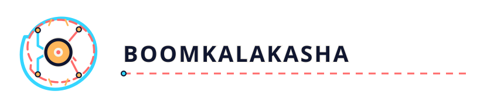
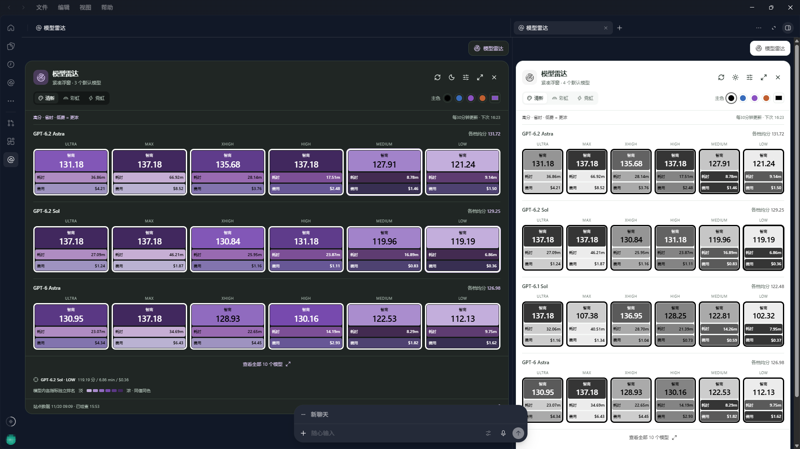

# Codex Model Radar · 模型雷达



[简体中文](README.zh-CN.md) · [Quick start](#quick-start) · [Preview](#preview) · [User guide](#user-guide) · [Releases](https://github.com/boomkalakasha/codex-model-radar-plugin/releases) · [Contributing](CONTRIBUTING.md) · [Support](SUPPORT.md) · [Security](SECURITY.md)

> **Keep model scores beside your conversation.**

A local Codex desktop plugin for comparing model scores, elapsed time and cost from Codex Radar. Open a compact conversation panel, pick your usual models and check the matrix without repeatedly opening a browser. A separate local process checks the source every 30 minutes; no model call is needed for updates.

**数据署名：数据来自 Codex 雷达 [codexradar.com](https://codexradar.com/)。💗**

This is an independent viewer. The source site's data, methodology and names remain attributed to their owners; the software license does not relicense them.

## At a glance

| You want to… | Use… | Result |
| --- | --- | --- |
| Check your usual models | A compact panel with saved model selection and order | Your preferred rows beside the conversation |
| Compare score, time and cost | Independent rankings for each metric within each model | Higher scores, lower time and lower cost receive deeper shades |
| Match your workspace | Fresh, rainbow or neon modes; quick and custom accents | Light/dark outer frames with neutral internal gaps |
| Avoid repeated source-page visits | A 30-minute local refresh, manual refresh and last-good cache | Source time and local check time shown separately |

## Quick start

**Requirements:** Windows, Node.js 22 or later, and a Codex desktop version supporting local plugins and MCP App conversation panels. The native CLI tested for the initial version is `0.171.0-alpha.13`; other versions and other operating systems are not verified.

1. Download `codex-model-radar-plugin-1.0.1.zip` and `SHA256SUMS.txt` from the [latest release](https://github.com/boomkalakasha/codex-model-radar-plugin/releases/latest). Verify the ZIP with `Get-FileHash -Algorithm SHA256`, then extract it to a persistent folder.
2. Open PowerShell in the extracted folder and run:

   ```powershell
   .\Install.ps1
   ```

   For a separate Codex profile, use `-CodexHome 'path-to-your-codex-home'`. The installer uses `CODEX_HOME` when set, otherwise your user profile's `.codex` directory. It discovers the native Codex CLI; `-CodexBin` and `-NodeBin` can override executable paths.
3. In that Codex instance, open **模型雷达** from the conversation panel's plugin entry. A sidebar application entry is also declared. If a new entry is missing, save your work and reopen that instance.

You should see the model matrix, a source timestamp and a next-check time. Use the close/radar button to collapse and reopen it, and the settings button to choose your default models. Installation may complete while the source is unavailable: use the retry button or wait for the next check. The prebuilt ZIP needs no `npm install`.

## Preview



The owner-provided screenshot shows the plugin in the native Codex interface, with different themes and model selections. Displayed values are a historical snapshot, not current benchmark claims. [Open the original data page](https://codexradar.com/#iq) for the latest publication. This repository does not provide a hosted plugin demo.

## User guide

- **Open and close:** use the radar button or ×. Expand shows all available models; collapse returns to your saved selection. This is a Codex conversation panel, not an operating-system floating window.
- **Default models:** choose high-score, low-cost or short-time presets, or check models manually and use the up/down controls to order them. Keep at least one model selected.
- **Colors:** Fresh uses a black default accent, with blue, purple, orange and custom colors. Rainbow uses red, orange, yellow, green, cyan, blue and purple, with red marking the best rank. Neon uses a dark background.
- **Read the shades:** each model ranks its own score, time and cost separately. Better means deeper; ties share a color and missing settings are excluded. Shades do not compare different models. Narrow panels wrap six effort settings into two rows.
- **Source:** click the attribution link to open Codex Radar. “Source data” is the site's publication time; “checked” is the local check time. Checks do not imply that the source published new data.

### Refresh and local storage

The installer starts one hidden local process. It continues checking every 30 minutes after the panel or MCP connection closes. Sleep suspends networking; after resume, the worker checks whether an update is due within roughly a minute. Failed fetches or changed source markup retain the last validated snapshot.

No system service or login task is installed. After a computer restart, loading the plugin starts the worker again. Data, preferences and the latest 200 events stay under `<CODEX_HOME>/model-radar`; `runtime.json` contains a private local communication token and must not be shared.

The worker reads public HTML, cross-checks the matrix against metadata from the same publication and does not execute source-page scripts. The UI communicates through Codex tools; its scripts, styles and icons are bundled locally. The source has no guaranteed stable parsing contract, so site changes may require a plugin update.

### Upgrade, uninstall and troubleshooting

To upgrade, first run the uninstall command below from the current installation folder to stop its worker. Extract the new release into the **same folder path**, rerun the installer for the same Codex home, then reopen Codex. Keep the previous ZIP for rollback; preferences and cache remain separate. Codex rejects a different folder for an already registered marketplace name. The installer leaves existing sources unchanged; moving a source requires deliberate source management or a separate Codex home.

To stop the worker and uninstall, run this from the folder used to install:

```powershell
node scripts/uninstall.mjs
```

Preferences and cache remain. Removing the plugin through Codex alone does not stop an already running worker. The installer keeps a private pre-install config backup under `internal/`; restore individual plugin settings when needed, rather than overwriting later unrelated changes.

| Problem | Check |
| --- | --- |
| No plugin entry | The selected Codex home, desktop version, then reopen the same instance |
| First fetch fails | Retry; check access to [the source](https://codexradar.com/) |
| Old data after a failed refresh | The visible error and source time; last-good cache is intentional |
| Deep link opens another profile | Open the plugin from the installed instance; Windows may route links to the default instance |
| Installer cannot find executables | Pass `-CodexBin` and `-NodeBin`; do not change model/provider settings |

## Development and validation

```powershell
npm ci
npm run build
npm test
npm run preview
```

The preview command prints a loopback address for a sandboxed MCP test host. It uses the same bundled UI and a real stdio MCP connection, with a separate local test cache. It is a development tool, not the installed plugin entry.

The tests cover parsing, mixed-publication rejection, scheduled refresh, retained cache, persisted preferences, local API access and the MCP UI resource contract. Test data is synthetic. The initial local version also passed browser checks for themes, rankings, model ordering, retry, source links and narrow layouts; the screenshot is separate owner-provided evidence of native rendering. It does not establish compatibility with every Codex version.

Source layout: `src/data.mjs` parses the publication; `worker.mjs` schedules and caches; `runtime.mjs` starts/reuses the worker; `mcp.mjs` declares tools and UI; `app.mjs`, `view.mjs` and `panel.css` render the panel. `scripts/install.mjs` binds the installed cache to the chosen Node executable and profile. [Maintenance and release guide](docs/maintenance.md).

## License and credits

Original software: [Apache-2.0](LICENSE). Bundled dependency notices ship in `plugin/dist/THIRD-PARTY-NOTICES.txt`. [Third-party and screenshot scope](THIRD-PARTY-NOTICES.md). Data remains attributed to [Codex Radar](https://codexradar.com/). BOOMKALAKASHA branding is reused from the owner's [AI-first Vibe Coding](https://github.com/boomkalakasha/ai-first-vibe-coding-skill) project. Codex and other third-party names identify compatibility and do not imply endorsement.
