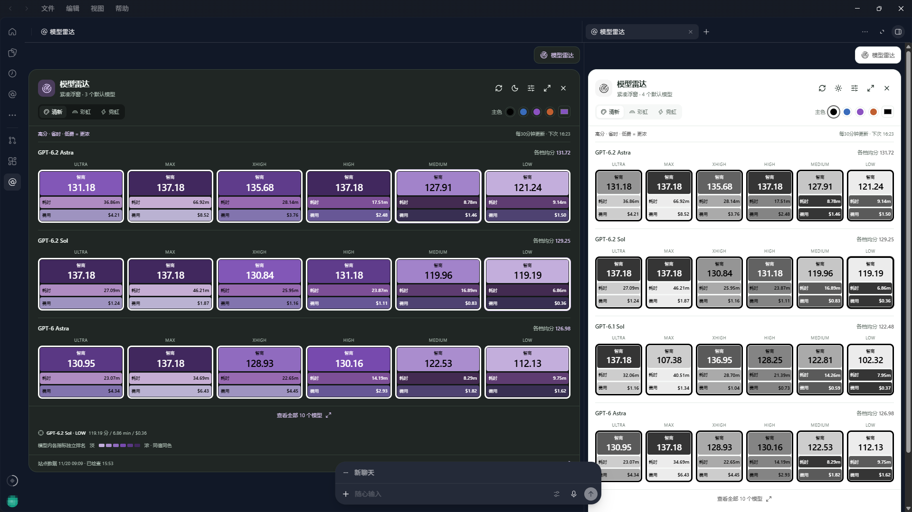

# Codex Model Radar · 模型雷达


[English](README.md) · [快速开始](#快速开始) · [效果预览](#效果预览) · [使用指南](#使用指南) · [版本发布](https://github.com/boomkalakasha/codex-model-radar-plugin/releases) · [参与贡献](CONTRIBUTING.md) · [使用支持](SUPPORT.md) · [安全说明](SECURITY.md)

> **把模型表现放在对话旁边。**

一个 Codex 桌面端本地插件，在紧凑的对话侧面板中查看 Codex 雷达的智商、耗时、费用矩阵。选好常用模型后，无需反复打开浏览器。独立本机进程每 30 分钟检查一次数据，更新不消耗模型调用。

**数据署名：数据来自 Codex 雷达 [codexradar.com](https://codexradar.com/)。💗**

这是独立的数据查看工具。数据、评测方法及相关名称仍归原权利人，代码许可证不改变它们的权利归属。

## 场景概览

| 想做什么 | 怎样操作 | 得到什么 |
| --- | --- | --- |
| 随手看常用模型 | 对话侧面板，保存默认模型与顺序 | 常用模型固定在手边 |
| 比较智商、耗时与费用 | 每个模型内，三项指标分别排名 | 高分、低耗时、低费用颜色更浓 |
| 匹配工作区配色 | 清新、彩虹、霓虹，快捷或自定义主色 | 深浅外框切换，内部保持中性间隔 |
| 减少来回打开原站 | 每 30 分钟检查，可手动刷新，失败保留缓存 | 分开显示站点发布时间与本机检查时间 |

## 快速开始

**需要：** Windows、Node.js 22 及以上，以及支持本地插件和 MCP App 对话侧面板的 Codex 桌面版。初版实测原生 CLI 为 `0.171.0-alpha.13`；其他版本、其他操作系统尚未验证。

1. 从[最新 Release](https://github.com/boomkalakasha/codex-model-radar-plugin/releases/latest) 下载 `codex-model-radar-plugin-1.0.1.zip` 和 `SHA256SUMS.txt`。用 `Get-FileHash -Algorithm SHA256` 核对 ZIP 后，解压到长期保留的目录。
2. 在解压目录打开 PowerShell，运行：

   ```powershell
   .\Install.ps1
   ```

   多实例可加 `-CodexHome '目标 Codex 实例目录'`。安装器优先使用 `CODEX_HOME`，未设置时使用用户目录下的 `.codex`。安装器会发现原生 Codex CLI，也支持用 `-CodexBin`、`-NodeBin` 指定可执行文件。
3. 在该实例的对话侧面板插件入口选择 **模型雷达**。插件也声明了侧栏应用入口。若暂未出现，保存工作后重新打开同一个实例。

预期会看到模型矩阵、站点数据时间和下次检查时间。右上角按钮一键收起/展开，设置按钮调整默认模型。源站暂时不可用时安装仍可完成，可点击重试或等待下轮检查。预编译 ZIP 无需运行 `npm install`。

## 效果预览



截图由项目所有者提供，展示原生 Codex 中的不同主题和模型选择。图中数值为历史快照，不代表当前评测结论。最新数据请访问[原始榜单页面](https://codexradar.com/#iq)。本仓库没有托管插件在线演示。

## 使用指南

- **开关与展开：** 点击雷达按钮或 × 收起，再点按钮展开；展开全部可看所有模型，收起回到默认列表。这是 Codex 对话侧面板，不是系统级独立浮窗。
- **默认模型：** 可选高分、低费用、少耗时预设，也可逐个勾选并上下调整顺序。至少保留一个模型。
- **配色：** 清新默认黑色，可选蓝、紫、橙及自定义颜色；彩虹使用赤橙黄绿青蓝紫七正色，赤色对应最佳名次；霓虹采用深色背景。
- **色阶含义：** 每个模型内，智商、耗时、费用各自排序；表现越好颜色越浓，同值同色，缺失档位不参与。色深不能用于跨模型比较。窄面板会将六档排列为两行。
- **来源：** 点击署名链接打开 Codex 雷达。页脚“站点数据”是来源发布时间，“已检查”是本机检查时间，检查成功不等于来源刚刚更新。

### 后台更新与本地数据

安装时会启动一个隐藏的本机数据进程。关闭面板或 MCP 连接后，它仍每 30 分钟检查一次。电脑睡眠期间无法抓取，恢复后约一分钟内检查是否到期。断网或来源结构变化时保留上次有效数据，并显示失败状态。

不安装系统服务或开机任务。电脑重启后，首次加载插件会恢复后台进程。数据、偏好和最近 200 条事件保存在 `<CODEX_HOME>/model-radar`；`runtime.json` 含本机通信令牌，不应分享。

插件只读公开 HTML，将矩阵与同份页面中的发布元数据交叉校验，不执行来源页面脚本。界面通过 Codex 工具通信，脚本、样式、图标均在本机打包。来源没有保证稳定的解析接口，网页改版时插件可能需要更新。

### 升级、卸载与排查

升级时解压新 Release，对同一 Codex home 运行安装器，再重新打开 Codex。保留上一版用于恢复；偏好独立于插件缓存。安装源目录被本地插件市场引用，移动目录后应重新安装。

要停止后台进程并卸载，在当初安装的目录运行：

```powershell
node scripts/uninstall.mjs
```

偏好与缓存会保留。仅在 Codex 中移除插件，不会停止已运行的数据进程。安装器会在 `internal/` 保留私有的改前配置备份；恢复时按需处理插件设置，不整份覆盖其他窗口后续修改。

| 遇到的问题 | 检查顺序 |
| --- | --- |
| 没有插件入口 | 目标 Codex home、桌面版本，再重开同一个实例 |
| 首次取数失败 | 点击重试，检查能否访问[原站](https://codexradar.com/) |
| 刷新失败后仍有旧数据 | 查看错误提示和站点时间；这是保留缓存的预期行为 |
| 深链接打开了另一实例 | 从已安装的实例中打开；Windows 可能路由到默认实例 |
| 安装器找不到程序 | 指定 `-CodexBin` 和 `-NodeBin`，无需改模型或提供方配置 |

## 开发与验证

```powershell
npm ci
npm run build
npm test
npm run preview
```

预览命令打印本机回环地址，通过沙箱 MCP 测试宿主加载相同界面，并使用真实 stdio MCP 连接和独立测试缓存；它是开发工具，不是正式插件入口。

测试覆盖解析、发布数据不一致时拒绝替换缓存、定时刷新、失败保留、偏好持久化、本机 API 访问控制及 MCP UI 资源契约，测试数据为合成样例。初版还完成了主题、排名、模型排序、重试、来源跳转和窄屏的浏览器检查；截图是所有者提供的原生渲染证据，不能证明所有 Codex 版本都兼容。

源码导航：`src/data.mjs` 解析发布页面；`worker.mjs` 调度与缓存；`runtime.mjs` 启动和复用进程；`mcp.mjs` 声明工具和 UI；`app.mjs`、`view.mjs`、`panel.css` 渲染面板。`scripts/install.mjs` 将安装缓存绑定到目标 Node 和实例。[维护与发布说明](docs/maintenance.md)。

## 许可证与致谢

原创软件使用 [Apache-2.0](LICENSE)。构建依赖的完整通知随 `plugin/dist/THIRD-PARTY-NOTICES.txt` 分发。[第三方内容与截图范围](THIRD-PARTY-NOTICES.md)。数据持续署名 [Codex 雷达](https://codexradar.com/)。BOOMKALAKASHA 品牌沿用所有者的 [AI-first Vibe Coding](https://github.com/boomkalakasha/ai-first-vibe-coding-skill) 项目。Codex 等名称用于说明兼容对象，不代表官方背书。
